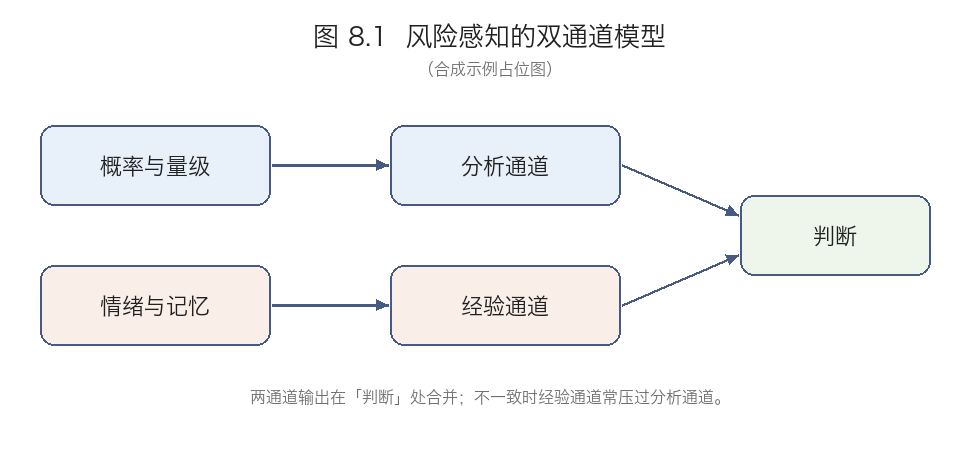

# 第 8 章 风险感知与公共沟通 · 脉络梳理

> **版本／边界**：合成示例材料；自章首「Learning Points」与章内导言起，至 8.7 末；不含章末 Suggestions for Further Reading。
>
> **读者基础**：有相关学科基础，无本书领域基础（档位②）
>
> **模式／档位**：① 对原文的梳理 ｜ 标准
>
> **篇幅**：各节按原文篇幅占比分配（最长节 8.2 为 319 字、最短节 8.7 为 83 字，比值 3.84，超过 1.75 阈值），标准档 7 节的预算取区间中值 2,700 字；主线 335 + 收束 269 = 604；逐节预算 =（2,700 − 604 = 2,096）× 该节占比 × k，k 取 1.0 左右（实际 1.02–1.16，均在 0.6–1.4 内）；8.7 是纯列举、无论证的节，按地板 100 字计。实际逐节合计 2,281，比逐节预算高 8.8%，未超过 ±10%，不触发归一。全章正文 2,885 字，落在标准档 7 节区间 2,250–3,150 内。**本篇所有字数均按去标点计**（中文字符、数字、外文各计 1）。

## 全章主线

本章要回答的不是「公众为什么不懂风险」，而是「当两种风险判断并存时，凭什么判定其中一种是错的」。作者先排除两个流行回答——公众不理性、专家不可信——因为二者都把分歧视作能力问题。排除之后框架不能凭空提出，必须先确立风险本身有两个含义，否则批评任何一边都站不住。这一结论同时为双方划出合法性，却也留下难题：既然都合法，偏差如何定位？接下来两节分头处理，把偏差定位在公众一侧的系统性来源，把分歧从能力移回权重。偏差与分歧分家之后，才需要一个把两者装进同一结构的框架，说明它们为何需要不同干预。框架立起来，策略比较才有依据：缺口可能在信息也可能在权重，所以三类策略不是三种风格而是三种代价。最后讨论被收回到更前置的条件——三类策略都依赖信任，而信任不是沟通的产物。而整条批评链都建立在一个尚未检查的假设上：双方说的「风险」是同一个东西。若不是，谁都没算错。

### 8.1 风险的两个含义

先要确认双方说的「风险」是不是同一个东西。专家的风险是单位时间内的期望损失，把各种后果乘以其概率再相加；它只要求后果与概率两类输入，因此可独立于判断者算出同一个数。公众的风险则不只是一个量，而包含可控性、公平性、灾难性、代际影响等维度；这些维度合起来也给不出一个可比的排序。因此一个每年致死人数很小的技术，若损害不可控、分布不公、后果不可逆，公众仍会评为高风险——他们不是在同一个数上算错，而是在回答另一个问题。作者据此立下双边约束：不能把公众的多维判断化简为「他们算错了期望损失」，因为期望损失不含公平与可控性；也不能说专家的单维度量「忽视了人的维度」，因为多维判断给不出可比的排序，要排序就得先引入权重。*诠释*：这一约束先把批评双方同时解除武装，否则后面任何论证都会被读成站队。两种含义各自合法之后，问题才转成：既然两边都不算错，公众的判断为何仍会系统性偏离专家的量？

### 8.2 感知偏差的来源

上一节确立两边都合法，偏差却仍出在公众一侧，来源有两类。可用性捷思指人们用「多容易想起例子」代替频率估计：越容易提取的类别，越容易被判定为常见。被媒体密集报道的事件容易想起，于是被高估；不报道的则被低估。被替换掉的不是计算，而是输入：提取的难易被当成了频率的证据。报道是选择性的，误差不会在个体之间抵消，只会朝同一侧累积。情感捷思指第一情绪反应直接决定风险评估，且不可穿透——人们事后会为情绪给出的判断补理由，却改不动判断本身。补理由发生在判断之后，因此理由充分与否不能反过来检验判断。边栏的「风险的社会放大」把视角移到社会层：事件经媒体与社交网络传播，社会影响可远超直接损害，且与客观量级无关；放大不是夸大，而是让影响扩散到损害之外。两类偏差的共同点在于：它们不产生随机误差，而产生系统性偏移——偏差有固定方向、可由来源预测，因此扩大样本或补充解释都消不掉。*诠释*：两类捷思分别作用在「估频率」与「下评价」两个环节，却共享同一个后果——错误不是分散的噪声，而是可预测的偏移；这正是后文不能靠「多给信息」解决偏差的理由。这给下一节留下一个必须处理的反驳：如果公众的判断确实系统性偏离，最省事的解释就是他们不理性。

*本节练习*：1. 举一个自己高估频率的例子，并判断由哪一类捷思造成。2. 若媒体停止报道，可用性偏差是否会消失。

### 8.3 专家与公众的分歧是不是非理性

偏差归到捷思，最省事的解释就落成「公众不理性」。本节处理两个反驳，一个针对公众，一个针对专家。其一说公众不懂概率因而不理性，作者回应：不懂概率不等于非理性；非理性若要成立，必须指出一处推理错误，而不懂概率只说明公众没按专家的方式计算。多维判断要把各维度合成总评，这需要权重，而权重没有客观答案——没有人能证明公平性该折算成多少单位的死亡风险。公众做的是加权，专家做的是单维度量；加权不精确，但不是推理错误。*诠释*：这条回应是防守性的，作者只能主张公众的加权不错，不能主张它对。其二说专家也有偏差、两边一样不可信，作者回应：偏差类型不同，不能推出等值——公众的偏差在加权，专家的偏差在度量，后者可被审计，前者不能靠同一套办法纠正。承认专家有偏差只说明度量需要被审计，不说明度量与感知可以互相替代。结论落在「分歧的来源是权重而不是能力」：若症结在能力，补信息即可；症结在权重，补信息不够。这给下一节留下任务：需要一个同时安放两者的结构。

### 8.4 双通道模型

上一节要求一个同时安放权重与能力的结构。

双通道模型就是这个结构，也是本章的组织框架和唯一一张图。感知由两个通道并行产生：分析通道处理概率与量级，经验通道处理情绪与记忆；两者各自独立出结果，没有先后之分。两通道输出在「判断」处合并，不一致时经验通道往往压过分析通道。这张图不只是描述，它把 8.2 与 8.3 接了起来：偏差来自经验通道对分析通道的压制——易想起的事件与先到的情绪使经验输出盖过分析输出；分歧来自加权时使用的维度不同——双方不是在同一张维度表上算出不同的数，而是带着不同维度进入合成。这是两个问题，不能指望同一种干预同时解决：补充信息改变分析通道的输入，协商权重改变合成规则；前者不能让情绪判断变得可穿透，后者不能让被忽略的概率重新进入视野。这一区分是后面策略比较的前提——先判断缺口在信息还是在权重，才谈得上选哪一类策略。

### 8.5 三类沟通策略

缺口在信息还是在权重既已分开，策略的比较才有意义。三类策略按代价区分，而不是按效果排序。告知是把专家结论翻译成公众语言，代价是预设公众缺的是信息；这个预设同时决定了它的适用边界——若缺口在权重，告知不改变判断，只增加「已经解释过了」的挫败，因为被重复的是同一套折算方式，而分歧恰在折算方式上。说服则以框架设定与情感诉求推动行为，短期有效，但长期损害机构可信度——公众一旦察觉自己被推动而非被说明，后续信息都会被折价；折价一旦发生，同一机构再回到告知策略也要付出更高成本。参与让公众或其代表进入决策，代价是耗时、结果不可控、责任分散；而技术风险恰恰需要明确的责任人，当没有人能为最终决定负责时，合法性提高了，可追责性却下降了。作者由此给出一个非排序性的结论：三类不是优劣，而是代价互换，选哪一类取决于当前缺的是信息、行为改变还是决策合法性。*诠释*：三种代价并不同质——告知的代价是无效，说服的代价是失信，参与的代价是失责，三者之间不存在可换算的汇率，这正是「代价互换」一说没有给出现成判据的原因。这给下一节留下一个问题：既然三类策略各自都要支付代价，为什么它们会同时受制于同一个条件？

*本节练习*：1. 选一个熟悉的公共沟通案例，判断其类别并指出支付的代价。2. 若机构既缺信任又缺时间，哪一类最不可行。

### 8.6 信任作为前置条件

本节把 8.5 的讨论收回到一个更前置的条件。三类策略全部依赖信任，而信任不是沟通的产物，它是沟通的前提。这里的「前提」是解释上的：同一句话在高信任与低信任下会被读成不同东西。常被弄反的是顺序——机构先做沟通、指望它建立信任，结果在低信任下，告知被读成掩饰，说服被读成操纵，参与被读成推卸责任；三种策略同时失效，原因不在策略本身。这也是信任被放在策略比较之后的原因：先看清每类策略各需要什么，才能说明它们共同需要什么。这给末节留下缺口：信任既是前提又无法由沟通产生，它如何测量、如何修复，本章没有答案。

### 8.7 未解决的问题

信任的测量与修复悬着，另有两处也同样悬着。本章留下三个未决问题：双通道模型只说明两通道并行且会冲突，没有给出两通道合成的规则；信任如何测量、如何修复没有共识；参与式决策能在多大范围扩展缺少可靠证据。*诠释*：三者性质不同：第一条是框架内部的缺口，后两条是框架之外的空白。

## 全章收束

上面那条「一处在内、两处在外」的分界，正是章末立场地图的形状：两个流行回答被排除，一个是「公众不理性」，一个是「专家不可信」；留下来的是三件互相支撑的东西——两种风险含义不可还原、偏差与分歧分属不同问题、策略之间是代价互换而非优劣排序。各处的取舍并不对称：双通道框架换来说明力，却交出了合成规则；参与策略换来决策合法性，却交出了责任归属；信任被前置为条件，代价是它既无法测量也无法修复。因此本章立得最稳的是否定性的部分——为什么另外两种回答不成立——而建设性的部分都留着缺口：前者只需排除，后者需要给出规则，而规则正是本章欠得最多的东西。值得一提的是，本章最强的那句「信任是前提」恰恰是最没有可操作入口的一句。

## 术语注

- **客观风险**（8.1）：可独立于判断者计算的量；本章用它指专家的单维度量。
- **感知风险**（8.1）：判断者实际持有的多维评估，含可控性、公平性、灾难性、代际影响等。
- **期望损失**（8.1）：各种后果乘以其概率后求和；本章中它不代表「真实的」风险，只是量的一种。
- **可用性捷思**（8.2）：用回忆的难易程度代替频率估计。
- **情感捷思**（8.2）：第一情绪反应直接决定风险评估。
- **不可穿透**（8.2）：情绪判断事后可被合理化、但改不动判断本身；本章采用较强版本，原文注明此说在后续文献中有争议（Notes 2）。
- **风险的社会放大**（8.2 边栏）：事件的社会影响远超其直接损害。本章的界定不要求经可识别的传播链条，与 Kasperson 等人的用法有别（Notes 6）。
- **权重**（8.3）：把各维度折合成总评时使用的系数；无客观解，本章用它解释分歧来源。
- **非理性**（8.3）：本章限于推理错误，不含「不精确」。
- **分析通道**（8.4）：处理概率与量级的通道。
- **经验通道**（8.4）：处理情绪与记忆的通道。
- **压制**（8.4）：两通道输出冲突时经验通道占优的现象。
- **告知策略**（8.5）：以补充信息为主要手段。
- **说服策略**（8.5）：以框架设定与情感诉求推动具体行为。
- **参与式决策**（8.5）：让公众或其代表进入决策过程。
- **信任**（8.6）：本章把它界定为沟通的前提而非产物。

## 存疑项

- **未能核实**：Notes 1、3、6 所引 Tversky & Kahneman (1973)、Slovic 双系统图示、Kasperson 等人的原始论文未核对原版，转述以本书表述与标注为准；8.2 的媒体报道密度数据依 Note 4 转引，未溯源。
- **原文问题**：8.5 说服策略段「会损害会损害机构可信度」重复两字；8.4「两通道的合成的规则」语序不通。
