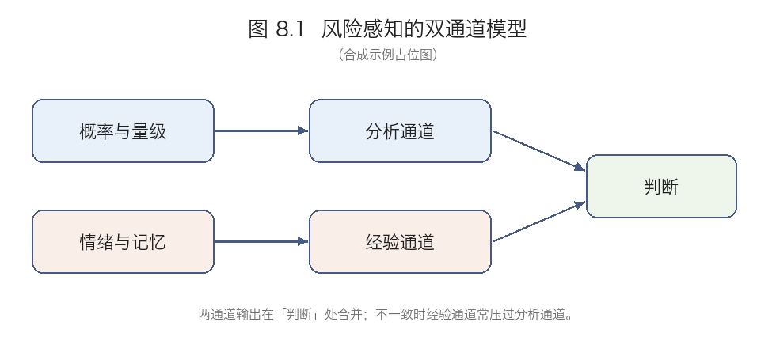

# 合成示例：整章输入

> **本文件是为新标准编写的合成材料**，不是任何真实教材的节选。「第 8 章 风险感知与公共沟通」及其全部小节、图、边栏、注释、练习均为虚构，仅用于示范「整章输入 — 标准档梳理输出」的关系。为了便于评审，篇幅被压缩到结构完整但内容简短的程度。

---

# 第 8 章 风险感知与公共沟通

**Learning Points**

- 区分风险的客观度量与主观感知，并说明二者为何不能互相还原
- 说明可用性捷思与情感捷思如何系统性扭曲频率判断
- 比较告知、说服、参与三类沟通策略各自付出的代价

本章讨论一个看似简单的问题：为什么公众对风险的判断常常与专家不同。常见的两种回答都不成立。一种说公众不懂概率，所以不理性；另一种说专家被体制俘获，所以不可信。本章要论证的是第三种回答：两者使用的信息通道不同，而通道的差异有可追踪的来源。如果这一论证成立，那么公共沟通的问题就不是「如何把专家结论灌输给公众」，而是「如何在两个通道之间建立可核对的关系」。为此，本章先澄清风险的两个含义，再定位偏差的来源，然后排除「非理性」这一解释，提出双通道模型，最后比较三类沟通策略的代价。信任问题被放到了策略比较之后，而不是之前，理由见 8.6。

## 8.1 风险的两个含义

专家语境中的「风险」通常指单位时间内的期望损失，是一个可计算的量：把各种后果乘以其概率再相加。公众语境中的「风险」则不只是一个量，它包含可控性、公平性、灾难性、对后代的影响等多个维度。一个每年致死人数很小的技术，如果它的损害不可控、分布不公、且后果不可逆，公众仍会把它评为高风险。

本节要确立的结论是：这两个含义不能互相还原。不能把公众的多维判断化简为「他们算错了期望损失」，因为期望损失这个量本身不包含公平和可控性；也不能把专家的单维度量说成是「忽视了人的维度」，因为多维判断无法给出可比的排序。两者回答的是不同的问题。

## 8.2 感知偏差的来源

在公众这一侧，偏差有两类稳定来源。第一类是可用性捷思：人们用「多容易想起例子」来估计事件频率。媒体密集报道的事件变得容易想起，于是被高估；不报道的事件则被低估。第二类是情感捷思：对某类事件的第一反应情绪会影响对其风险的评估，而且这种影响是**不可穿透的**——人们事后会为情绪给出的判断补上理由，却改不动那个判断。

> **边栏 8.1 定义**
> 风险的社会放大：指一个风险事件经由媒体与社交网络的传播，其社会影响远超其直接损害；放大不是夸大，它与事件的客观量级可以无关。

这两类偏差的共同点是：它们不产生随机误差，而产生系统性偏移。因此不能用「样本更大」或「解释更充分」来消除。

**节末练习**

1. 举一个你自己高估了频率的例子，并判断它更可能由可用性捷思还是情感捷思造成。
2. 如果媒体停止报道某类事件，可用性捷思带来的偏差会消失吗？说明理由。

## 8.3 专家与公众的分歧是不是非理性

有两种常见的反驳需要处理。

反驳一：公众确实不懂概率，所以他们的判断是非理性的。回应：不懂概率不等于非理性。在多维风险判断中，把各维度合成为一个总评需要**权重**，而权重本身没有客观答案——没有人能证明公平性应当折算成多少单位的死亡风险。公众做的是加权，专家做的是单维度量；加权不精确，但不是推理错误。

反驳二：专家也有偏差，所以两边一样不可信。回应：专家的偏差确实存在，但类型不同，而且不能由此推出两者等值。承认专家有偏差，只说明度量需要被审计，不说明度量与感知可以互相替代。

本节的结论是：分歧的来源是权重，而不是能力。

## 8.4 双通道模型

图 8.1 给出本章的组织框架。感知由两个通道并行产生：分析通道处理概率与量级，经验通道处理情绪与记忆。两个通道的输出在「判断」处合并，而当两者不一致时，经验通道往往压过分析通道。

这张图的作用不只是描述，它把 8.2 与 8.3 接了起来：偏差来自经验通道对分析通道的压制，分歧来自加权时使用的维度不同。这是两个不同的问题，因此不能用同一种干预去解决——补充信息针对的是前一个，协商权重针对的是后一个。

## 8.5 三类沟通策略

**告知**：把专家结论翻译成公众能理解的语言。它的代价是预设了公众缺的是信息；如果缺口在权重而不在信息，告知不会改变判断，只会增加「已经解释过了」的挫败感。

**说服**：用框架设定与情感诉求推动具体行为。它短期有效，但长期会损害会损害机构可信度——一旦公众察觉自己被推动而非被说明，后续所有信息都会被折价。

**参与**：让公众或其代表进入决策过程。它的代价是耗时、结果不可控，且责任分散：没有人能对最终决定负责，而技术风险恰恰需要明确的责任人。

三类策略不是优劣排序，而是代价互换。选择哪一类，取决于当前缺的是信息、是行为改变，还是决策的合法性。

**节末练习**

1. 选一个你熟悉的公共沟通案例，判断它属于哪一类，并指出它支付了什么代价。
2. 如果机构既缺信任又缺时间，三类策略中哪一种最不可行？为什么？

## 8.6 信任作为前置条件

三类策略全部依赖信任，而信任不是沟通的产物，它是沟通的前提。这一点常被弄反：机构先做沟通，指望沟通建立信任，结果在低信任条件下，告知被读成掩饰，说服被读成操纵，参与被读成推卸责任。因此信任问题必须在策略选择之前处理，这也是它被放在 8.5 之后而不是之前讨论的原因——先看清每类策略各需要什么，才能说明它们共同需要什么。

## 8.7 未解决的问题

本章留下了三个问题。其一，双通道模型只说明了两个通道并行且会冲突，没有给出两通道的合成的规则。其二，信任如何测量、如何修复，目前没有共识。其三，参与式决策在多大范围内可扩展，缺少可靠证据。

---

**Notes**

1. 可用性捷思的原始表述见 Tversky & Kahneman (1973)。
2. 情感捷思「不可穿透」的说法在后续文献中有争议，本章采用的是较强版本。
3. 图 8.1 改编自 Slovic 的双系统图示。
4. 8.2 提到的媒体报道密度数据来自某年度报告。
5. 8.5 的参与式决策案例见某地规划实践的研究。
6. 本章对「风险的社会放大」的界定与 Kasperson 等人的用法略有不同：本章不要求放大必须经由可识别的传播链条。

**Suggestions for Further Reading**

Loewenstein 等关于情感与决策的综述；Kasperson 等关于风险社会放大的原始论文；一篇关于参与式预算的元分析。

---

## 边界说明（供示例评审用，不属于原文）

- 章首 **Learning Points** 与 8.1 之前的**章内导言**：计入，仅作为主线段落的依据，不单独成节。
- **边栏 8.1**：按其功能并入 8.2。
- **图 8.1**：承担论证功能，需保留（裁图嵌入）。
- **节末练习**：原文只在 8.2、8.5 后有，照原文位置放在该节末尾。
- **Notes 1、2、6**：承担论证功能，随文；**3、4、5**：纯出处，忽略。
- **Suggestions for Further Reading**：完全忽略。
- 原文文字层瑕疵（供演示「存疑项」）：8.5 说服策略段「会损害会损害机构可信度」重复；8.4「两通道的合成的规则」语序不通。
